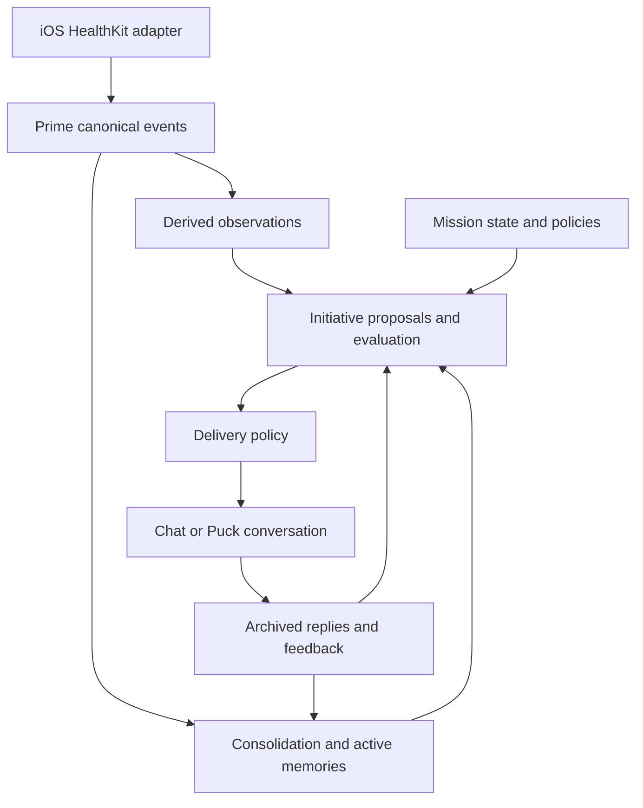

# Gremlin Missions, Initiative, and HealthKit direction

Status: directional design; no implementation commitment or release date.
Decision date: 2026-10-08.
Parent: [Gremlin roadmap](../roadmap.md).
The locked [v0.1 specification](../v0.1_spec.md) remains unchanged.

## Product decisions

Lars wants Gremlin to initiate actual conversations across health, development,
brewing, infrastructure, music, and other relevant subjects. Initiative may
include topics he has not explicitly asked Gremlin to monitor and low-stakes
curiosity without a productivity objective. This is an accepted product
direction, subject to configurable user boundaries.

A native iOS client should be able to read selected HealthKit data and submit
meaningful events to Gremlin. Health ingestion and conversational initiative
are independently useful capabilities. Neither is a reason to ship a general
workflow engine, continuously running agent, or new service by default.

## Place in the milestone sequence

M14–M16 are provisional planning identifiers, not delivery promises. M11,
M12, and the existing M13 integration direction retain their scope.

| Stage | Contribution | Dependency or boundary |
| --- | --- | --- |
| M1–M8 | Canonical ingestion, provenance, authorized retrieval, MCP, export and release proof | Existing foundation |
| M9 | Background processing of interactions and events | Imported events use the existing consolidation path |
| M10 | Memory lifecycle and reconstruction | Initiative uses active memory and retains source evidence |
| M11 | Operations, observability and cost accounting | Bound evaluation work and expose failure/cost before unattended delivery |
| M12 | Declarative client and agent profiles | Describe native-client ingestion and evaluator read scopes; profiles do not execute agents |
| M13 | Bounded integrations | Establish one source contract at a time; HealthKit follows these rules |
| M14 | Persistent Missions | Own objectives, policies, triggers, state and continuity across disposable executions |
| M15 | Conversational Initiative | Persist proposals, evaluation decisions, delivery and follow-up across clients/models |
| M16 | Native iOS HealthKit ingestion | Supply authorized health events and optional deterministic observations |
| Puck / Gremlin Chat | User-facing interaction | Display a delivered opener and resume its conversation; native iOS shell remains a separate implementation decision |
| Runner | Disposable execution | Own containers, PTYs and execution lifecycle; Prime receives no Docker socket |

Recommended path: establish M11 visibility and the minimum profile/policy
contracts; prove a small Mission slice; prove Initiative using existing
conversation history; add HealthKit as another source. A foreground-only
HealthKit ingestion experiment may proceed independently once its ingestion
and privacy boundaries are ready. HealthKit does not depend on M15, and M15
does not depend on HealthKit or completion of every M13 integration.

## Ownership and information flow

Prime owns canonical interactions/events, memory, provenance and authorization.
The Mission capability owns durable objectives and continuity. Initiative owns
conversation proposals and their operational lifecycle. Chat/Puck handles
conversation delivery and interaction. Runner owns disposable executions.
The iOS adapter owns on-device HealthKit access and a retryable local outbox.

These are logical responsibilities. Their process/service placement should
follow the first working vertical slice.

Source data, derived interpretation and operational proposal state must remain
distinct. Health events are not authoritative memories; conversation proposals
are not user facts. Evaluation and delivery decisions retain audit history.
Delivered assistant messages and user responses enter the interaction archive.
Rebuilding memory must not redeliver old proposals or discard dismissal,
delivery, or Mission history.

## M14 — Persistent Missions

A Mission holds an objective, supporting context, policies, approval rules,
triggers, state and append-only history. It can survive process restart,
model replacement and multiple disposable Runner executions.

The first slice should prove one explicit objective, one bounded trigger and
a visible state/history view. Persistent state belongs to Gremlin; execution
belongs to Runner where execution is needed. An in-process evaluation job
does not require an agent container.

Acceptance:

- A Mission survives restart and resumes from durable state.
- Evaluation references authorized evidence and records its outcome.
- Pausing a Mission prevents future work; resuming is explicit.
- Actions obey the Mission's approval policy and existing execution boundary.
- A failed execution preserves Mission continuity and produces a visible failure.

## M15 — Conversational Initiative

### Design principle

### Product philosophy: ambient agency, transparent autonomy

Gremlin aims to feel present through continuity, contextual awareness and
justified initiative, not by imitating a friend, claiming affection or
pretending to have human motives. It may reach out when it has a grounded
reason; an occasional low-stakes opener is permissible within user-selected
limits, but generating engagement is not itself a reason to interrupt.

Presence is not personhood. The interface should offer a deliberate way to
break anthropomorphic impressions: users can dismiss an initiative or inspect
*why* it happened without being forced to read technical explanations in the
normal conversation. Explanations describe recorded system evidence and
decisions, never fabricated feelings or purported hidden model thoughts.

### User control and auditable initiative

- Provide global do-not-disturb for a specified duration, quiet hours,
  per-topic snooze, one-off dismissal, and persistent topic opt-out.
  Suppression persists across clients, restarts and model changes.
- Treat dismissals as explicit scoped feedback. Silence is not rejection.
  A previously explained observation should not prompt repeated contact
  without meaningful new evidence or a user-approved follow-up.
- Enforce suppression, permissions, rate limits and delivery budgets in a
  deterministic policy gate; model-assessed urgency cannot override it.
  Any exceptional delivery category requires explicit user authorization.
- Persist an append-only decision ledger for **every** candidate, including
  rejected, suppressed, postponed and expired proposals, not just messages
  actually delivered. Capture trigger, evidence/provenance, model and
  evaluation version, policy checks/version, decision, delivery attempts,
  user feedback and outcome.
- Make a discreet “Why this message?” affordance available for each
  initiative. Render explanations from recorded inputs, policy results and
  tool/evaluation events; do not ask an LLM to invent retrospective
  reasoning. Apply current authorization and privacy rules to audit views.
- Allow a user to ask why an expected notification was *not* delivered.
  Audit retention and sensitive evidence visibility require explicit policy.

Example: three days of elevated resting heart rate alongside declining
sleep scores may produce a cautious conversation opener **only** when the
data is sufficiently fresh and reliable and health-related outreach is
enabled. Gremlin should present observations, not a diagnosis or a claim
that it is emotionally worried.

Gremlin may autonomously propose and initiate conversations based on relevant
memories, observations, associations and ongoing objectives, including topics
not explicitly requested by the user. Every initiative must be traceable to
its supporting context, respect user-defined boundaries, and remain dismissible
without consequence.

Initiative is broader than alerts or reminders. Reactive responses, proactive
observations and associative conversation starters coexist. A proposal may
have an optional Mission reference; curiosity must not require a fabricated
objective.

### Proposal and evaluation

Candidate sources include new events, observations, unfinished conversations,
Mission triggers, memory associations and bounded exploratory reviews.
An LLM may suggest associations or wording; it cannot decide authorization
or bypass delivery policy.

Each proposal should retain:

- topic, proposed opener and reason for bringing it up
- canonical evidence references and supporting memory IDs where applicable
- originating trigger, optional Mission ID and related conversation/initiative
- generator/model/version and evaluation timestamp
- novelty, relevance, evidence quality, priority and expiry decisions
- deduplication identity, policy version and delivery outcome

Deterministic checks should handle access, freshness, novelty against past
initiatives, cooldowns, quiet hours, rate/cost budgets and expiry. Model judgment
may assess conversational relevance after authorized context has been selected.
Recheck evidence validity and permissions before delivery.

Use an explicit lifecycle:

`candidate → evaluated → queued → delivered → engaged / dismissed / expired`

Evaluation may reject a candidate with a recorded reason; queued candidates
can expire. Expiry after delivery means a response window ended, not that
the user rejected the topic. Silence remains unknown. Explicit feedback can
guide later decisions; it must not become a silent negative preference.

Record a delivery attempt separately from user engagement. Retries must not
create duplicate assistant messages or notify multiple clients repeatedly.
A delivered opener has a stable initiative/conversation link so the user can
continue it later from another authorized client.

### Interaction and delivery policy

Support initiative intensity, topic boundaries, pause/mute, quiet hours,
cooldowns, interruption budgets and explicit dismiss/snooze feedback. Allow
occasional low-stakes curiosity within that budget. Health access does not
automatically grant permission for health-related interruptions.

Start with an opener visible inside Chat/Puck. Add push delivery separately:
a notification points to the durable conversation and is not the sole record.
Showing an opener in-app and sending a push are separate outcomes. A push
failure must not erase or duplicate the conversation.

“Why did you bring this up?” should expose retained evidence and evaluation
reasons, subject to current authorization. It should never require the model
to invent a retrospective explanation.

### First slice and acceptance

Use one unfinished conversation or grounded association from existing history,
one bounded evaluator, an in-app opener and a resumable conversation. Do not
require HealthKit, push, exhaustive memory scans or a continuously running agent.

- Gremlin initiates without a new user message, using authorized evidence.
- One useful association outside an explicitly monitored topic can be proposed.
- An initiative without a Mission is supported.
- The opener, reply and follow-up remain linked across restart/client change.
- Repeated evaluation, delivery retry and memory rebuild produce no duplicates.
- Quiet hours, cooldown, pause, expiry and topic mute are enforced server-side.
- An explicit dismissal is retained; unanswered delivery is not treated as rejection.
- Invalidated evidence or lost permissions block pending delivery.
- The user can inspect why the topic was raised without unauthorized data exposure.
- Provider failure and budget exhaustion are visible and leave candidates retryable
  according to bounded policy, with no false successful delivery.

## M16 — Native iOS HealthKit ingestion

### Scope and client choice

HealthKit requires a native-capable iOS adapter with the HealthKit entitlement
and per-data-type user authorization. This supplies the concrete phone-specific
requirement previously deferred in Puck planning. Keep shared domain/network
contracts in TypeScript where useful; choose Swift/SwiftUI or a supported native
bridge after a small on-device proof. No framework choice is locked here.

Initial candidates are sleep, walking/workouts, daily activity and resting
heart rate. Start with one meaningful metric, a bounded historical window and
foreground synchronization. No HealthKit writes are required.

Apple Health read permission and permission to upload to Gremlin are separate
boundaries. Explain selected types, historical window, destination and
retention before enabling synchronization. An empty query is not proof of
zero activity or a known denial of read permission.

### Event contract and reliability

Use authenticated event ingestion; the credential determines the principal.
Before unattended sync, add or verify server-enforced idempotency for this
source. Do not assume today's generic event endpoint already provides it.

Retain source identity, sample/aggregate identity, measurement start/end,
ingestion time, units, source/device attribution where available, adapter
version and any aggregation rule/version. Daily summaries also retain their
timezone and reporting window. Avoid blindly summing overlapping phone/watch
samples. Define overlap and sleep-stage handling per metric.

Select meaningful samples or bounded summaries instead of exporting an
unlimited telemetry stream. If on-device aggregation is used, label it as
such and retain enough inputs/provenance to explain the imported summary;
do not imply Prime holds samples it never received.

Persist the outbox and query cursor safely. Advance the durable cursor only
after fetched changes are safely in the outbox; remove outbox entries after
server acknowledgement. Unknown network outcomes can retry using the same
idempotency identity. Support incremental changes and deletions: append
correction/retraction events linked to original imports rather than silently
rewriting the canonical archive.

Later background delivery uses platform-supported observation and incremental
queries. It is opportunistic, not an exact scheduler or a guaranteed real-time
feed; foreground catch-up and explicit freshness remain necessary.

### Health namespace and observations

Enforce health-specific source access and derived-memory namespaces in Prime
and the consolidation path. A payload label or ingestion permission alone is
not a privacy boundary. Restrict consolidation/evaluation inputs before they
leave Prime, including calls to external model providers. Decide which health
data, if any, may be included in those calls.

Use deterministic, versioned observations for rolling baselines, trends,
deviations and data coverage. An observation references its event evidence,
time window and calculation version, and can be rebuilt. Sparse data,
late sync and overlapping records must not become confident negative claims.
Statistical associations remain distinct from medical conclusions.

Stopping synchronization stops future uploads. Source retractions affect
derived observations; privacy deletion is a separate deliberate, auditable
operation under Prime's existing exceptional-deletion principle. Define its
effect on derived memory, retained proposals and backups before broad health
history import.

### First slice and acceptance

- The user selects one metric and enables reading and upload separately.
- A real on-device observation reaches authenticated Gremlin event ingestion.
- Offline capture, restart and retry preserve the event without duplication.
- Revoked/absent access and unavailable data produce no fabricated measurement.
- Corrections/deletions append provenance-linked retractions and trigger derived
  state reconciliation.
- An unauthorized client/evaluator cannot retrieve health data or health memories.
- Timestamp, units, source and reporting window survive export and restoration.
- Synchronization can be paused; last successful sync and pending failures are visible.
- A deterministic observation can later become an M15 proposal under a separately
  enabled health initiative policy.

## Open decisions before implementation

1. Promote only the next useful slice; confirm final milestone numbering and release.
2. Define the smallest Mission/Initiative storage and API contracts and cost budget.
3. Choose in-app delivery first, then push provider, device registration and deduplication.
4. Choose the iOS shell, signing/distribution route and first HealthKit metric.
5. Specify source access, consolidation namespace enforcement, external-provider policy
   and privacy deletion before importing sensitive history.
6. Define per-metric aggregation, cursor scope, idempotency and retraction semantics.

## Platform references

Platform mechanics should be rechecked when M16 is promoted.

- [Apple: authorizing access to health data](https://developer.apple.com/documentation/healthkit/authorizing-access-to-health-data)
- [Apple: reading data from HealthKit](https://developer.apple.com/documentation/healthkit/reading-data-from-healthkit)
- [Apple: executing anchored object queries](https://developer.apple.com/documentation/healthkit/executing-anchored-object-queries)
